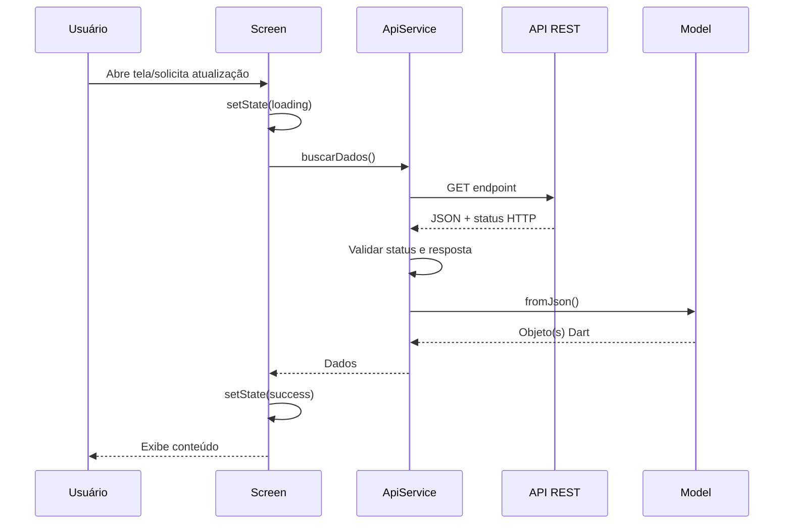

# Fluxo de dados

## Consulta à API

## Tratamento de erro
Se ocorrer falha de rede, timeout, status HTTP não esperado ou parsing inválido, o service deve propagar um erro tratável. A tela muda para `error`, apresenta mensagem compreensível e oferece retry.

## Onboarding
A Splash consulta `OnboardingPreferencesService`. Esse serviço encapsula `SharedPreferences`. O botão "Não mostrar novamente" salva `skipOnboarding = true`; "Começar" não salva nada (ver `onboarding-decision.md`).

## Pré-pedido
`CestaScreen` valida nome e telefone → `PedidoService.criar()` faz `POST /api/pedidos` → em `201` devolve `Pedido` com código → `HomeShell` limpa a cesta com `setState` e abre Meus pedidos.

## Triagem
`TriagemForm` envia as respostas para `MutiraoService.triagem()` (`POST /api/triagem`). A renda vai só no corpo da requisição; depois da resposta, o campo é limpo e nada é salvo.

## Contrato
Endpoints, exemplos de JSON e status em `docs/api/api-documentation.md`.
